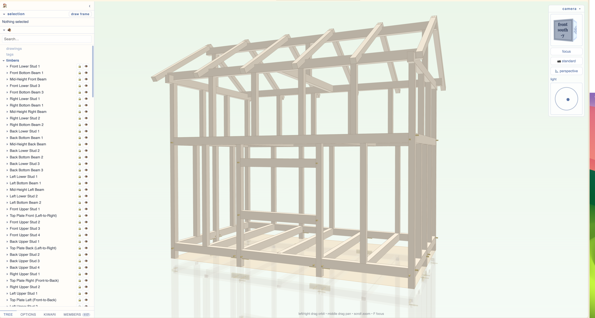

<h1 align="center">Kumiki</h1>

  <b>Programmatic CAD for timber framing and woodworking.</b> 
  Design frames and joinery in Python, and see them in 3D with Kigumi.

  <a href="https://github.com/minimapletinytools/kumiki/releases">Releases</a> ·
  <a href="https://kumiki.build/try/">Try it online</a> ·
  <a href="https://kumiki.build">Website</a> ·
  <a href="https://kumiki.build/docs/">Docs</a> ·
  <a href="https://github.com/minimapletinytools/kumiki/discussions">Discussions</a> ·
  <a href="https://discord.gg/cQhUG7WJ8">Discord</a>

  
  
  
  

Kumiki is a **programmatic** CAD library for timber framing and woodworking. You write a frame as
Python: timbers, the joints that connect them, and the drawings that describe them. Change a
timber and every joint that touches it is recut.

Because designs are code, Kumiki works well with AI agents 🤖. Describe what you want to build,
and your agent writes the frame.

Kumiki is free and open source. Try it out! There are many more features to come.

> [!NOTE]
> Expect breaking changes, each with a minor version bump. Your agent can fix frames broken by an
> API change using the [changelog](CHANGELOG.md).

## Features

- **Parametric joinery.** More than 30 joints (mortise and tenon, dovetails, laps, scarfs, pegs,
  wedges and more), each worked out from the timbers it joins.
- **Live 3D preview in Kigumi.** Select down to a face, walk a joint's CSG tree, use X-ray and
  section views, and measure.
- **Drawings (beta).** Plans and dimensioned shop drawings, generated from the frame itself.
- **Assembly order (beta).** Kumiki works out the order a frame goes together, and plays it back.
- **Export.** STL, OBJ, 3MF and STEP.
- **Built for agents.** Kigumi installs agent instructions with each project, has an agent of its
  own, and an MCP server so your agent can see what it built.

## Get started

Kumiki is best used with **Kigumi**, its viewer:

| | |
|---|---|
| **Desktop app** (recommended) | Mac and Windows, from the [releases page](https://github.com/minimapletinytools/kumiki/releases) or [kumiki.build/install](https://kumiki.build/install). Use it with your own agent. |
| **VS Code extension** | From the [Marketplace](https://marketplace.visualstudio.com/items?itemName=minimaple.kigumi), or [Open VSX](https://open-vsx.org/extension/minimaple/kigumi) for Cursor. |
| **In your browser** (beta) | [kumiki.build/try](https://kumiki.build/try/). Nothing to install, with a limited agent: good for a first look. |

Kigumi sets up Python and Kumiki for you. You can also use Kumiki on its own with
`pip install kumiki`.

### Your first project

In the app, click **New Project** and pick a folder. In VS Code, open a folder and click
**Initialize Project** in the Kigumi sidebar. Then click **New Frame…** at the bottom of the frames
list, or ask your agent to make one for you.

### Patterns and examples

Kumiki ships with a pattern book of joints and several example frames, listed in Kigumi's
explorer. Choose **View Source** to read one, or **Duplicate to Workspace** to make your own copy.

## Designing frames

Kumiki designs are built with code. You can write it yourself, or ask an agent to write it for
you.

### With an agent

Kigumi installs a set of agent instructions in each project. The installed `kumiki` package
includes the library's source, its patterns and its docs, so your agent has everything it needs in
the project's Python environment.

Plain prompts work well, and carpentry and woodworking terms work better. See the pattern book for
the joints available. It's best to build a structure in steps, previewing each one, but I won't
stop you from asking your agent to "build me a house". You can implement your own joints too,
though agents struggle with that today, especially without the terms for the geometry you want.
Better prompting examples and skills are coming.

### By hand

Start with [docs/concepts.md](docs/concepts.md) for Kumiki's design philosophy, then read the
example frames that ship with it. Kumiki is simple and verbose by design: it *looks* complex, but
each step is easy to follow. A typical structure is built like this:

1. Establish a footprint.
2. Raise foundational timbers on the footprint.
3. Join them with more timbers to complete the structure's shape.
4. Cut joints where the timbers meet.

Knowing these steps helps you direct an agent, too. Instead of "I want my building to be an L
shape", try "establish an L-shaped footprint for the building". And if you have questions, ask
the agent to explain.

## Drawings (beta)

Kumiki and Kigumi make drawings, plans and blueprints in three ways:

- **Generated** from the frame.
- **Coded** in your frame file.
- **Added by hand** in Kigumi.

Ask your agent to add drawings to your file to get started. To add a dimension by hand, open a
drawing, select the feature to measure from, press the measure button (or <kbd>M</kbd>) and select
the feature to measure to. With no drawings yet, select timbers and press **draw timber**, or
press **draw frame** with nothing selected to draw the whole frame.

You can also export STEP or STL files and make drawings in other software.

## Community

- **Questions and ideas:** [GitHub Discussions](https://github.com/minimapletinytools/kumiki/discussions)
- **Chat:** [Discord](https://discord.gg/cQhUG7WJ8)
- **Bugs and feature requests:** [Issues](https://github.com/minimapletinytools/kumiki/issues)

## Contributing

To contribute a new joint, add a file in `kumiki/joints/community` and add yourself as its
CODEOWNER. Community joints may later be promoted to the main joint folder.

For anything bigger, please get in touch first. There are plenty of joints and features to work
on :)

### Developing Kigumi

Kigumi is 100% AI slop, and it seems to not even be that awful :). Still, it's designed with more
care than I sometimes let on. There's no written architecture guide yet, and I'm opinionated about
it, so a bug report or feature request is often better than a pull request.

Pull requests that change anything under `kigumi/` need a signed
[Contributor License Agreement](CLA.md). The CLA bot asks on your first such PR and tells you what
to comment; you only sign once. Contributions to kumiki need no CLA.

## License

- **kumiki** (the Python library, its patterns and docs) is under the
  [Mozilla Public License 2.0](LICENSE).
- **kigumi** (the viewer: the VS Code extension and desktop app, in `kigumi/`) is under the
  [Elastic License 2.0](kigumi/LICENSE). You may use, modify and redistribute it freely, including
  commercially. You may not offer it to others as a hosted or managed service: the hosted web
  version of kigumi is published only by the project owner.

Releases of kigumi up to and including 0.7.2 were under MPL-2.0 and remain so. Third-party files
bundled with kigumi, such as those in `kigumi/webview/vendor/`, keep their own licenses.
